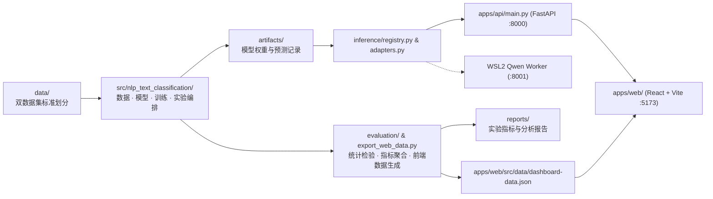

<h1 align="center">EmotionLab · nlp-text-classification</h1>

<p align="center">
  「自然语言处理之文本分类」课程项目<br>
  英文 GoEmotions 28 类多标签 · 中文电影评论二分类 · 四代模型范式对比 · 交互式评测与在线推理平台
</p>

<p align="center">
  <a href="#-项目简介">项目简介</a> ·
  <a href="#-快速开始">快速开始</a> ·
  <a href="#-系统架构">系统架构</a> ·
  <a href="#-实验体系与结果">实验体系与结果</a> ·
  <a href="#-测试与构建">测试与构建</a> ·
  <a href="#-文档导航">文档导航</a>
</p>

<p align="center">
  
  
  
  
  
  
</p>

## 项目简介

EmotionLab 围绕**英文细粒度多标签情绪识别**与**中文情感二分类**两项任务，在统一的数据划分、训练协议与 `Macro-F1` 评测口径下，系统对比了从传统机器学习到 4B 参数大语言模型微调的四代文本分类方法：

- **英文 GoEmotions（28 类多标签）**：共 54,054 条清洗后样本（训练 43,211 / 验证 5,416 / 测试 5,427），涵盖从高频 `neutral` 到极长尾 `grief` 等 28 种情绪标签。
- **中文电影评论（情感二分类）**：共 25,992 条清洗后样本（训练 19,994 / 验证 5,629 / 测试 369），正负类均衡。

项目包含完整的离线训练评测流水线与交互式 Web 演示平台（**EmotionLab**），支持：
1. **多模型实时推理**：通过统一后端接口调用传统 SVM、TextCNN、RNN/LSTM/BiLSTM、BERT 系列 Encoder 与 Qwen3.5-4B-Base QLoRA 进行单条文本在线预测与多模型对比。
2. **能力与统计分析**：展示推理延迟与训练时长的 Pareto 散点图、多维排序排行表、GoEmotions 28 类长尾 F1 分布，以及基于 100,000 次分层配对 Bootstrap（Bonferroni 校正）的架构演进与消融显著性检验。
3. **训练过程可视化**：呈现双数据集划分与类别分布，以及 51 组模型与随机种子组合的训练/验证收敛轨迹。

## 快速开始

### 1. 环境准备

| 组件 | 要求 | 用途 |
| --- | --- | --- |
| **Python** | `>= 3.10`（推荐 3.12） | 数据处理、模型训练评测、FastAPI 推理与静态数据导出 |
| **Node.js / npm** | 现代 LTS 版本 | 运行与构建 React / Vite 前端 |
| **WSL2 + CUDA**（可选） | 已配置 `emotionlab-s4-perf` 环境 | 运行 Qwen3.5-4B QLoRA 推理 Worker（`8001` 端口） |

```powershell
python -m pip install -e ".[dev,api]"
npm --prefix apps/web install
```

> 原始数据集、中文词向量（`wiki_word2vec_50.bin`）与本地模型权重保存在 `data/` 与 `artifacts/` 目录（受 `.gitignore` 管理）；仅含 Git 跟踪文件的仓库副本可直接运行前端静态分析展示、查看全部实验报告并执行离线单元测试。

### 2. 启动本地推理与展示平台

在仓库根目录分别启动 FastAPI 后端与 React/Vite 前端：

```powershell
# 终端 1：启动 FastAPI 推理服务（默认监听 127.0.0.1:8000）
.\.venv\Scripts\python.exe -m uvicorn apps.api.main:app --host 127.0.0.1 --port 8000

# 终端 2：启动前端界面（默认监听 127.0.0.1:5173）
npm --prefix apps/web run dev -- --host 127.0.0.1
```

如需在推理页面中调用 **Qwen3.5-4B-Base QLoRA**，在 WSL2 的同一仓库根目录下启动 Worker（默认监听 `127.0.0.1:8001`）：

```bash
bash scripts/start_qwen_worker_wsl.sh --preload-seed 42
```

启动后访问 [http://127.0.0.1:5173/](http://127.0.0.1:5173/) 即可体验 **01 推理测试**、**02 模型能力** 与 **03 训练数据** 三个交互章节。

## 系统架构



| 目录 | 职责 |
| --- | --- |
| `src/nlp_text_classification/` | 核心 Python 包：数据加载与审计（`data/`）、网络结构（`models/`）、训练器（`training/`）、实验调度（`experiments/`）、评测与统计检验（`evaluation/`）、推理适配（`inference/`）及统一 CLI（`cli.py`） |
| `apps/web/` | EmotionLab 交互式 Web 应用（React 19 + TypeScript + Vite 6） |
| `apps/api/` | FastAPI 在线推理服务，提供模型列表、元数据查询与单条/批量预测接口 |
| `apps/monitor/` | Qwen S4 训练过程只读监控看板 |
| `configs/` | 数据集配置、Batch A 实验矩阵、Batch B 模型资源与 Tokenization 规范 |
| `scripts/` | 前端数据导出脚本 `export_web_data.py`、全量校验脚本 `validate_all.py` 与 WSL2 启动脚本 |
| `reports/` | 各阶段实验结果 JSON、逐类 F1、Markdown/LaTeX 报告与训练曲线图 |
| `docs/` | 工程规范契约、数据盘点、阶段总结与过程记录 |

## 实验体系与结果

全项目累计完成 **62 组正式对比实验**（覆盖 **194,850** 条逐样本测试预测），完整结果与分析见以下文档：

| 实验阶段 | 模型与方法 | 正式规模 | 结果报告 |
| --- | --- | --- | --- |
| **Batch A** | TF-IDF + LinearSVC (E1)、TextCNN 及其词向量微调/静态消融 (E2/E5)、Vanilla RNN / LSTM / BiLSTM (E3) | 47 Run（含三种子复验） | [Batch A 总结](docs/finish-task/batch-a/summary.md) · [S1 24 轮验证](reports/batch-a-s1/report.md) · [S2 收敛边界](reports/batch-a-s2/report.md) |
| **Batch B Encoder** | DistilBERT (B1)、ModernBERT-base (B2)、ModernBERT-large (B3)、Chinese MacBERT-base (B4) | 12 Run（4 模型 × 3 种子） | [Encoder 实验报告](reports/batch-b-final/2605f6766085/report.md) |
| **Batch B Qwen** | Qwen3.5-4B-Base + QLoRA（GoEmotions） | 3 Run（3 种子） | [Qwen 性能报告](reports/batch-b-s4/performance/report.md) · [Qwen 最终报告](reports/batch-b-s4/formal/final-test.md) |

## 测试与构建

```powershell
# 运行 Python 单元测试与集成测试
.\.venv\Scripts\python.exe -m pytest -q

# 重新从本地实验产物生成前端评测数据（需本地 data/ 与 artifacts/）
.\.venv\Scripts\python.exe scripts/export_web_data.py

# 前端 TypeScript 类型检查与生产构建
npm --prefix apps/web run build
```

## 文档导航

| 文档 | 说明 |
| --- | --- |
| [文档总索引](docs/INDEX.md) | 全项目规范、实验报告与历史资料索引 |
| [系统架构](docs/ARCHITECTURE.md) | 代码目录边界与核心执行链路 |
| [实验数据盘点](docs/experiment-data-inventory.md) | 双数据集分布、62 组实验证据路径与取数口径 |
| [工程契约](docs/contracts/DATASETS.md) | [实验矩阵](docs/contracts/EXPERIMENT_MATRIX.md) · [实验协议](docs/contracts/EXPERIMENTS.md) · [评估指标](docs/contracts/EVALUATION.md) · [产物规范](docs/contracts/ARTIFACTS.md) |
| [前端与推理交接](docs/finish-task/frontend-freeze.md) | 前端三章功能说明、指标口径与本地启动指南 |
