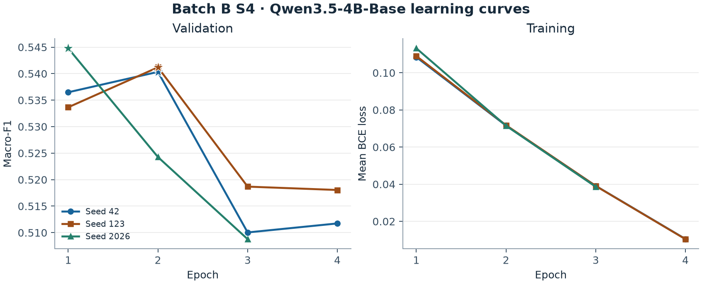

# Batch B S4 · Qwen3.5-4B-Base 正式测试

训练与选模使用 GoEmotions 固定的 43,211 条训练样本和 5,416 条验证样本。三组检查点按验证 Macro-F1 冻结，全程未读测试分区。独立测试使用同一官方 Qwen Revision `1001bb4d826a52d1f399e183466143f4da7b741b`，以及每个 Seed 的冻结 Adapter、分类头和阈值。 [训练与验证冻结](report-s4.md) · [冻结引用](freeze-ref.json)

## 正式结果

三种子正式测试的 **Macro-F1 为 0.535754 ± 0.004386**，验证 Macro-F1 为 0.542104 ± 0.002361。表中的离散程度为三 Seed 样本标准差（`ddof=1`）。

| Seed | 最佳轮次 / Step | 冻结阈值 | 验证 Macro-F1 | 测试 Macro-F1 | 测试 Micro-F1 | 测试 PR-AUC | 测试 Hamming Loss | 测试 Subset Accuracy |
| --- | --- | --- | --- | --- | --- | --- | --- | --- |
| 42 | 2 / 5402 | 0.20 | 0.540334 | 0.539418 | 0.598720 | 0.547211 | 0.040834 | 0.337571 |
| 123 | 2 / 5402 | 0.30 | 0.541193 | 0.530895 | 0.608177 | 0.542938 | 0.035004 | 0.432099 |
| 2026 | 1 / 2701 | 0.15 | 0.544786 | 0.536950 | 0.589895 | 0.544296 | 0.043427 | 0.308089 |
| 均值 ± 样本标准差 |  |  | 0.542104 ± 0.002361 | **0.535754 ± 0.004386** | 0.598930 ± 0.009143 | 0.544815 ± 0.002184 | 0.039755 ± 0.004314 | 0.359253 ± 0.064786 |

同分区上的三种子 Macro-F1 均值分别为 DistilBERT 0.490673、ModernBERT-base 0.515888、ModernBERT-large 0.537850。Qwen 高于前两者，较 ModernBERT-large 低 0.002096。ModernBERT-large 的 Micro-F1 和 Subset Accuracy 均值也更高，分别为 0.613607 和 0.402432。这些差值描述本批冻结模型在同一测试分区的表现。 [Encoder 冻结测试](../../batch-b-final/2605f6766085/report.md)

Macro-F1 对 28 个标签等权。测试集中 `grief`、`relief` 与 `pride` 分别有 6、11、16 条正例，平均逐类 F1 为 0.4804、0.3925、0.5172。`neutral` 有 1,787 条正例，平均 F1 为 0.6756。少数样本的预测变化可明显影响低支持标签的 F1。 [逐标签与全量指标](test-acceptance.json)

## 数据与评估记录

| 证据 | 核对结果 |
| --- | --- |
| 验证冻结 SHA-256 | `97ce29261f3844e715731f62f7859df2397db2e7381744bc8a0db86cff4e5d15` |
| 训练冻结边界 | `scope: validation_only`、`test_read: false` |
| 测试分区 | GoEmotions v1，5,427 个唯一样本，28 标签，和 train/validation 无 ID 重叠 |
| 测试分区 SHA-256 | `351ddec3f36c40b5a7391cf191312db900ee1723cc9469123f05a2a37c46dbba` |
| 输入 | 官方 Tokenizer，长度上限 64，右填充到 8 的倍数，实际截断 1 条 |
| 推理 | WSL2 RTX 4070 Ti SUPER，BF16 计算，batch 32，稳定长度排序并回填原始顺序，float32 sigmoid 分数 |
| 判定 | 每 Seed 的冻结全局阈值，`score >= threshold` |

独立前置审计先执行 `verified_freeze()`，核对验证清单、标签顺序、三个 Run 的身份、最优检查点状态和每个阈值，再离线核对官方模型与 Tokenizer。源测试文件于 2026-11-19 19:12:57（UTC+8）首次由 S4 正式测试入口读取，同一次读取完成 SHA-256 校验并存入本地版本目录。三个 Seed 和后续复核均使用该副本。 [前置审计](test-preaudit.json) · [固定评估契约](test-contract.json) · [阶段日志](test-progress.jsonl)

三个 Run 各输出 5,427 × 28 项分数。逐样本文件校验原始 ID、顺序、标签、预测和 SHA-256。`measure` 的结果由 sklearn 独立复算，容差 `1e-12`，包括 Macro-F1、Micro-F1、Samples-F1、Subset Accuracy、Hamming Loss、PR-AUC 和逐类指标。原始预测、冻结输入副本及检查点保留在本地 `artifacts/batch-b-s4/formal/`，Git 保存结构化签收与文件指纹。 [测试签收](test-acceptance.json) · [Tokenization 指纹](test-tokenization.json) · [LaTeX 结果表](test-results.tex)

正式推理于 19:20:07 完成。随后由独立 CPU 进程从已发布预测和本地缓存复核，3/3 通过，签收保持逐字节一致。日志记录一次源分区读取和三次模型加载。 [阶段日志](test-progress.jsonl)

## 训练轨迹

Seed 42、123 在第 2 轮达到验证峰值，Seed 2026 在第 1 轮达到峰值。三组后续轮次的验证 Macro-F1 均低于各自峰值，训练 BCE Loss 继续下降。三组按 patience 2 结束，实际训练轮数为 4、4、3。图中星号为最终冻结轮次。 [验证审计与逐轮数据](freeze-audit.json)

